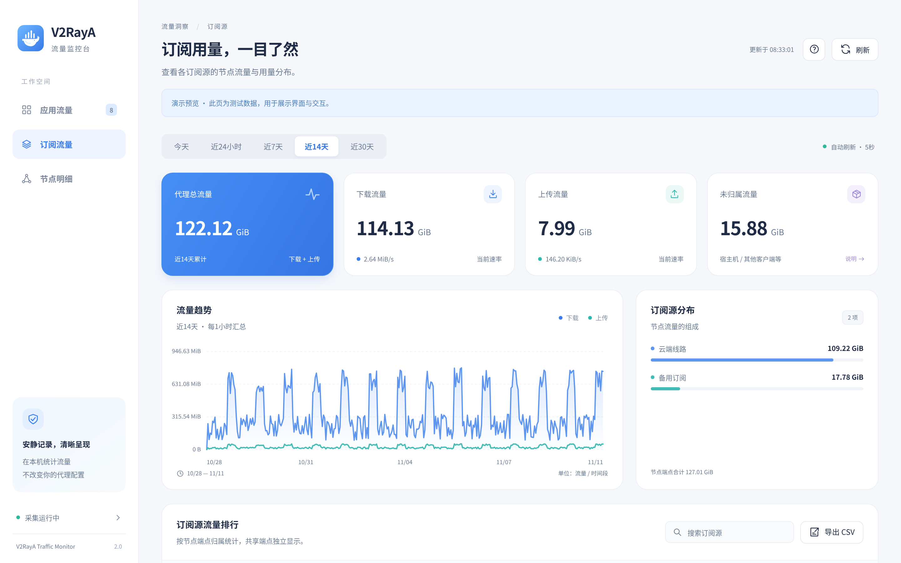
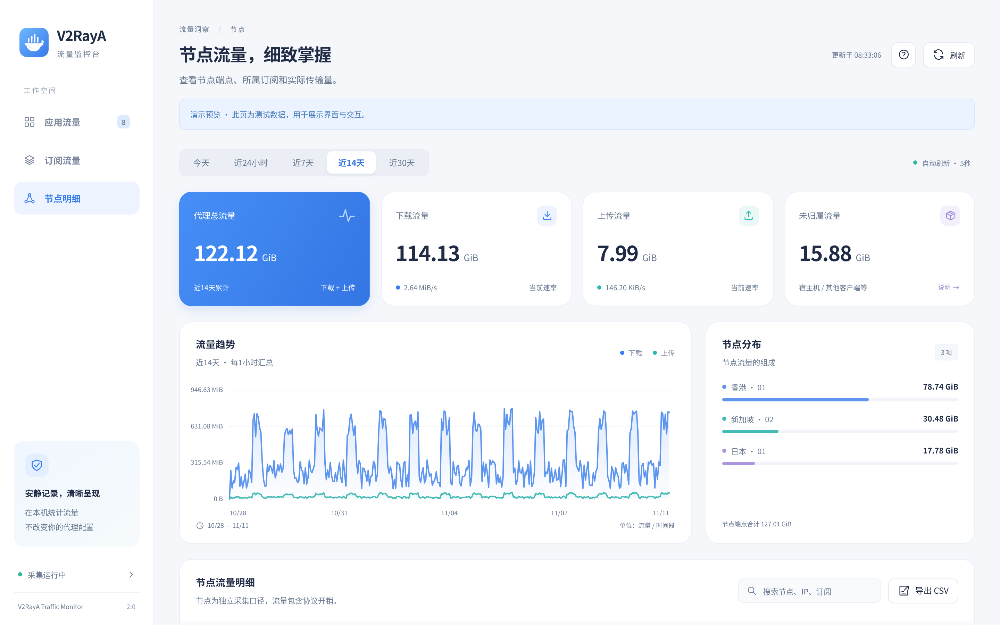
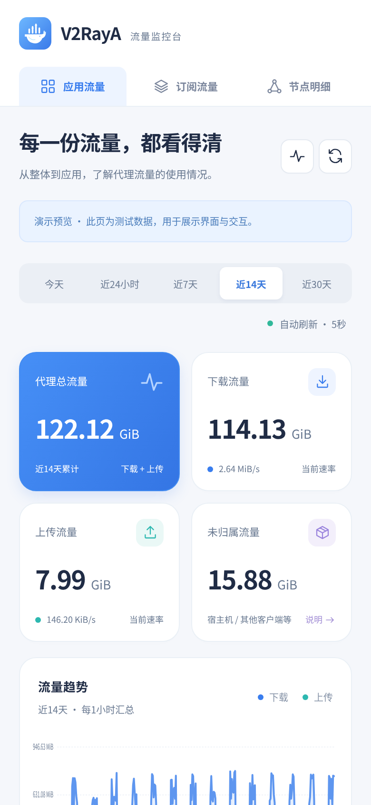

# V2RayA 流量监控

[](https://hub.docker.com/r/jieyousuozhang/v2raya-traffic-monitor)
[](https://hub.docker.com/r/jieyousuozhang/v2raya-traffic-monitor)
[](https://hub.docker.com/r/jieyousuozhang/v2raya-traffic-monitor/tags)

一个轻量、只读的 v2rayA 流量看板：用 nftables 旁路计数，把代理总流量拆到 Docker 应用、订阅源和节点三个维度。

不需要改 v2rayA 配置，不切换节点，不碰路由和其他防火墙规则。


## 功能

- **总览**：下载、上传、总流量、当前速率和未归属流量
- **应用排行**：按容器 IP 归属，自动发现新建容器
- **订阅与节点**：定时从 v2rayA API 同步，也支持手动节点清单
- **时间范围**：今天、近 24 小时、近 7 / 14 / 30 天
- **明细**：搜索、排序、分页，一键导出当前视图 CSV
- **状态可见**：采集、Docker 发现、订阅同步的状态和错误直接显示
- **轻依赖**：Python + Flask + waitress，前端无 CDN、无构建步骤

## 界面

### 订阅流量



### 节点明细



### 移动端



## 快速开始

### Docker Compose（推荐）

```yaml
services:
  v2raya-monitor:
    image: jieyousuozhang/v2raya-traffic-monitor:latest
    container_name: v2raya-monitor
    network_mode: host
    cap_add:
      - NET_ADMIN
    security_opt:
      - no-new-privileges:true
    restart: unless-stopped
    init: true
    mem_limit: 256m
    stop_grace_period: 45s
    environment:
      APP_PORT: "18765"
      V2RAYA_API_URL: "http://127.0.0.1:2017"
      V2RAYA_TARGET_PORTS: "20170,20171,20172"
      TZ: Asia/Shanghai
    volumes:
      - ./data:/data
      - ./v2raya-auth.json:/run/secrets/v2raya-auth.json:ro
      - /var/run/docker.sock:/var/run/docker.sock:ro
    healthcheck:
      test: ["CMD", "python", "-c", "import urllib.request;urllib.request.urlopen('http://127.0.0.1:18765/api/health',timeout=5).read()"]
      interval: 30s
      timeout: 8s
      retries: 3
      start_period: 45s
```

```bash
mkdir -p data
cp v2raya-auth.example.json v2raya-auth.json   # 填入 v2rayA 账号密码
docker compose up -d
```

打开 `http://<NAS-IP>:18765`。

### docker run

```bash
docker run -d \
  --name v2raya-monitor \
  --network host \
  --cap-add NET_ADMIN \
  --security-opt no-new-privileges:true \
  --restart unless-stopped \
  -e APP_PORT=18765 \
  -e V2RAYA_API_URL=http://127.0.0.1:2017 \
  -e V2RAYA_TARGET_PORTS=20170,20171,20172 \
  -v "$PWD/data:/data" \
  -v "$PWD/v2raya-auth.json:/run/secrets/v2raya-auth.json:ro" \
  -v /var/run/docker.sock:/var/run/docker.sock:ro \
  jieyousuozhang/v2raya-traffic-monitor:latest
```

### 前置条件

- 宿主机支持 `nf_tables`，容器需要 `NET_ADMIN`
- v2rayA 与监控容器在同一台机器，且使用 host 网络
- v2rayA API 默认可达 `http://127.0.0.1:2017`
- 只统计**显式代理端口**（默认 20170 / 20171 / 20172）上的流量

## 配置

| 变量 | 默认值 | 说明 |
| --- | --- | --- |
| `APP_HOST` | `0.0.0.0` | Web 监听地址 |
| `APP_PORT` | `18765` | Web 端口 |
| `DATABASE_PATH` | `/data/traffic.db` | SQLite 数据库 |
| `V2RAYA_API_URL` | `http://127.0.0.1:2017` | v2rayA API 地址 |
| `V2RAYA_AUTH_FILE` | `/run/secrets/v2raya-auth.json` | 账号文件（只读） |
| `V2RAYA_TARGET_PORTS` | `20170,20171,20172` | 要统计的代理端口 |
| `V2RAYA_SYNC_INTERVAL` | `60` | 订阅同步间隔（秒） |
| `FLUSH_INTERVAL` | `3` | 采样间隔（秒） |
| `RETENTION_DAYS` | `0` | 分钟记录保留天数，0 表示全部保留 |
| `TZ` | `Asia/Shanghai` | 「今天」按此时间区计算 |

账号文件格式：

```json
{"username": "your-v2raya-user", "password": "your-v2raya-password"}
```

不需要自动同步时，只提供 `data/nodes.json` 手动维护节点清单即可，程序会跳过登录。格式参考 `nodes.example.json`。

## 工作方式

```text
v2rayA / 容器 / 客户端
        │  显式代理端口 20170-20172
        ▼
  nftables counter（inet v2raya_mon_v2）
        │  每 3 秒采样增量
        ▼
  SQLite（分钟聚合）──► Flask + waitress ──► 浏览器 :18765
```

- **总流量**：统计目标端口上的全部报文，覆盖宿主程序、host 容器和局域网客户端
- **应用流量**：按容器 IP 匹配，自动维护规则，容器消失后会清理
- **订阅 / 节点**：读取 v2rayA 的订阅信息，按节点端点 `IP:端口` 建立独立计数器
- 规则使用独立表，不修改 v2rayA 和其他防火墙表

## 数据与权限

- `data/` 保存 SQLite 库与节点清单，请持久化
- `/var/run/docker.sock` 仅用于读取容器列表，只读挂载
- 容器只申请 `NET_ADMIN`，未启用特权模式
- 数据库结构自动初始化；从 1.x 迁移时生成 `traffic.db.pre-v2.bak`

## API

| 路径 | 说明 |
| --- | --- |
| `/api/health` | 健康检查（采集异常返回 503） |
| `/api/status` | 采集、Docker、同步状态 |
| `/api/dashboard` | 汇总、趋势与分布 |
| `/api/apps` | 应用维度明细 |
| `/api/nodes` / `/api/subs` | 节点与订阅明细 |
| `/api/proxy-total` | 总流量与未归属量 |
| `/api/export` | 当前视图 CSV |

## 本地开发

```bash
docker build -t v2raya-traffic-monitor:latest .
python -m scripts.demo --port 18780   # 演示数据，不启动采集器
pytest -q
```

前端文件在 `app/static/`，无需 npm 构建。

## 统计边界

- 不覆盖透明代理 / TUN、SOCKS5 动态 UDP 中继
- host 网络应用共享宿主网络，无法仅凭 IP 拆成独立应用
- 宿主重启或计数器被清空后，未采样的字节无法补回
- 报文统计包含协议头与重传，与文件大小不会完全相等
- 分钟精度，边界存在不足一分钟的误差

## 镜像标签

| 标签 | 说明 |
| --- | --- |
| `latest` | 当前稳定版 |
| `2.0.0` | 2.0.0 固定版本 |

```bash
docker pull jieyousuozhang/v2raya-traffic-monitor:latest
```
